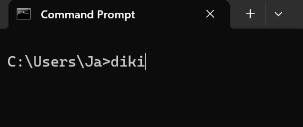
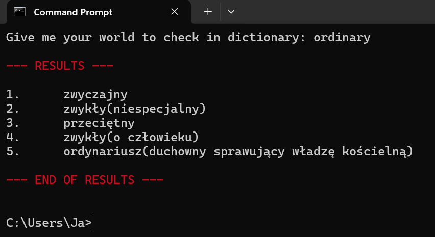
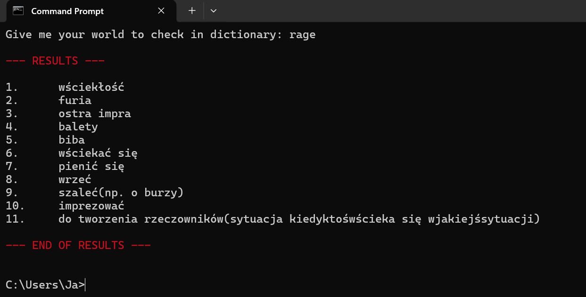
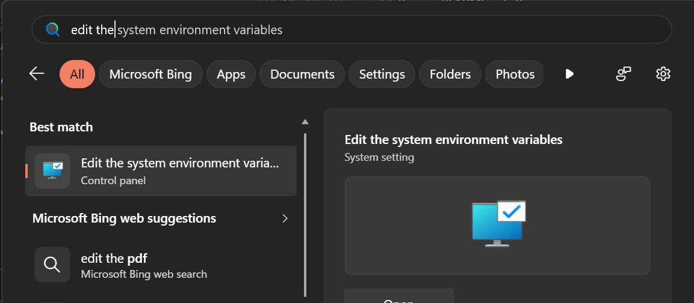
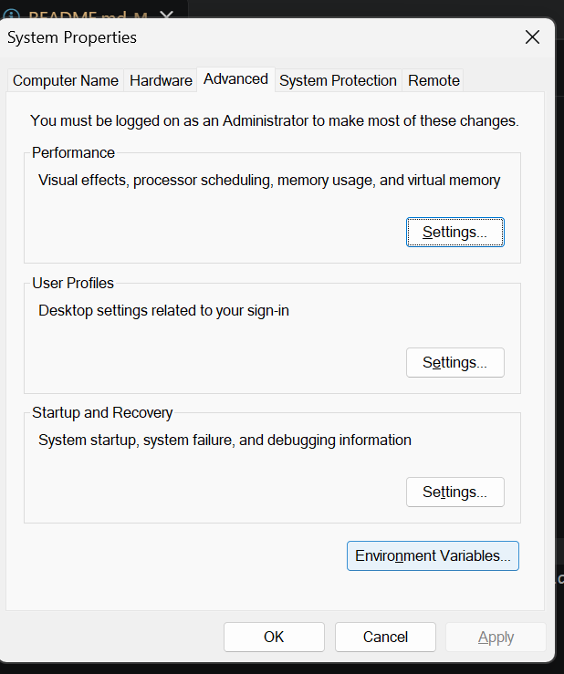
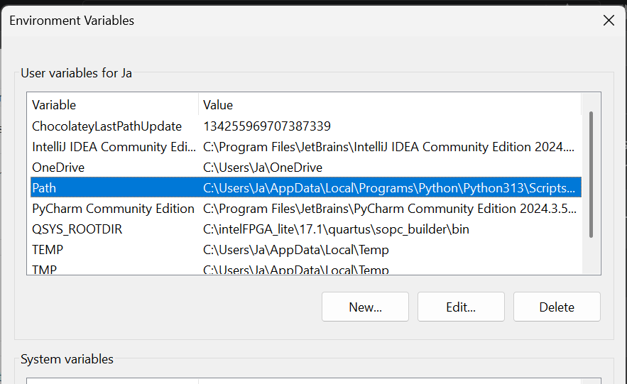
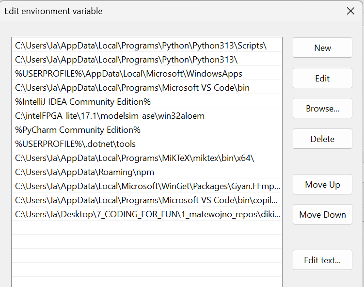

# CLI Diki Translator
` A lightweight command-line interface tool written in Python that fetches English word translations directly from [diki.pl](https://www.diki.pl/).`

## Screenshots
`Invoke diki`

`prompt your phrase`

`get results`

## Features
- Direct Web Scraping: *Uses `requests` and `BeautifulSoup` to parse dictionary entries seamlessly.*
- Terminal Color Support: *Formats CLI output with ANSI color codes.*
- Error Handling:\*\* Gracefully handles non-200 HTTP statuses and network timeouts.

## Requirements
-   `Python 3.x`
-   `requests`
-   `beautifulsoup4`

## Installation
1. Clone or download the repository.
2. Install the required dependencies:
```bash
 pip install -r requirements.txt
```

3. Run
```bash
python diki.py
```

4. Compile diki.py to exe
```bash
python ./setup.py build
```
5. Add ./build directory to path in your OS



```bash
# click <new> and
# paste the absolute path of your directory where */build/*/diki.exe is located
```


6. `Diki` works now!
